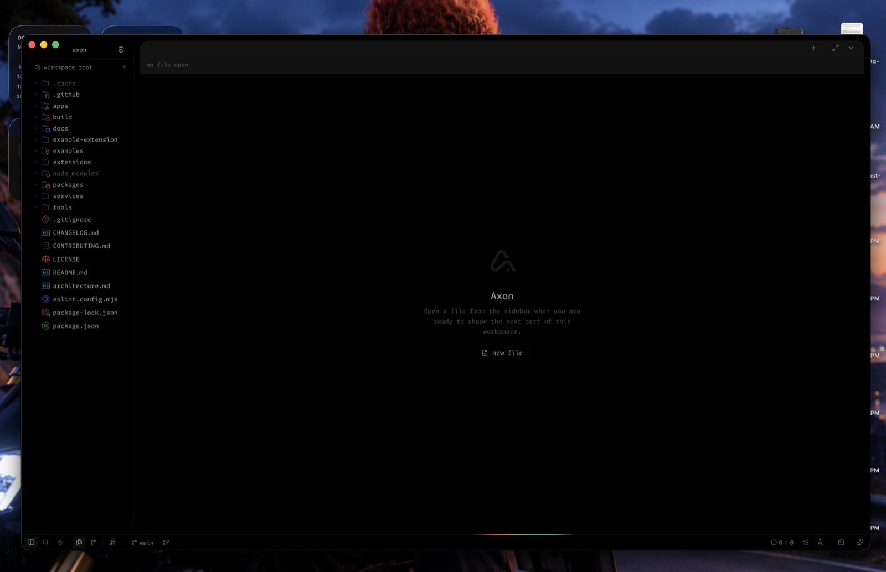
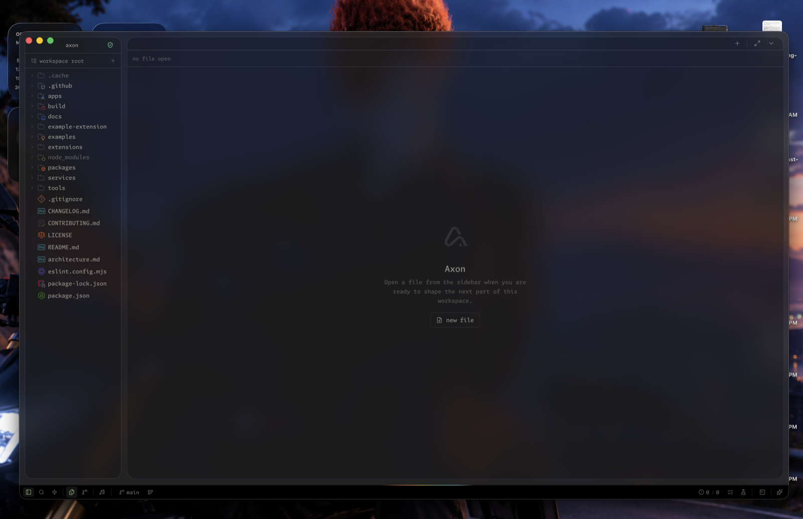

<!--
  Copyright (c) 2026 GordenArcher and Axon Editor Group. All rights reserved.
  Licensed under the MIT License. See LICENSE in the project root for license information.
-->

<p align="center">
  
</p>

<h1 align="center">Axon</h1>

<p align="center">
  A personal-first code editor with a local Go core and a tool-driven agent.
</p>

<p align="center">
  <a href="https://github.com/axon-editor/axon/actions/workflows/ci.yml"></a> <a href="https://github.com/axon-editor/axon/releases/latest"></a> <a href="LICENSE"></a> <a href="#download"></a>
</p>

Axon is a desktop code editor built for everyday work. It combines an Electron
and Monaco workbench with a Go core, language-server intelligence, a built-in
terminal, source control, and an agent that can plan and run workbench actions
after you approve them.

> **Status:** Axon is under active development. macOS builds are unsigned; see
> [Opening an unsigned build on macOS](#opening-an-unsigned-build-on-macos).

## Preview

The same workbench in two window styles.

### Solid Look

<p align="center">
  
</p>

### Glass Look

<p align="center">
  
</p>

## Highlights

| Area | What Axon does |
| --- | --- |
| **Workbench** | Multi-window workspaces, split panes, draggable tabs, shared Monaco models, command palette, workspace search, settings, and live Markdown and HTML previews. |
| **Agent** | A local, tool-driven assistant that reads files and diagnostics, proposes workbench actions, and runs edits only after approval. |
| **Agent CLI** | Interactive `axon` terminal sessions with workspace context, saved conversations, `axon resume`, slash commands, and streaming responses. |
| **Language intelligence** | LSP completion, hover, diagnostics, navigation, rename, and formatting, with bundled servers and on-demand native language tools. |
| **Source control** | Source control view, side-by-side diffs, live Git line paint, branch and stash workflows, worktrees, and a Git graph. |
| **Terminal** | Tabs, isolated PTY ownership, bounded replay, 200,000-line scrollback, and session health diagnostics. |
| **Testing** | A test explorer with project-aware provider discovery, target runs, and inline output. |
| **Appearance** | Built-in and custom themes, imported fonts, layered syntax coloring, Code Snapshot export, and a native glass window mode. |
| **Extensibility** | Declarative themes, icons, language metadata, and contributions, with a typed runtime API for trusted built-ins. |

See [Current Features](docs/CURRENT_FEATURES.md) for the complete list.

## Download

Download the latest build from
[GitHub Releases](https://github.com/axon-editor/axon/releases/latest).

| Platform | Artifact |
| --- | --- |
| macOS (Apple Silicon) | `Axon-<version>-arm64.dmg` |
| macOS (Intel) | `Axon-<version>.dmg` |
| Windows (x64) | `Axon.Setup.<version>.exe` |
| Linux (AppImage) | `Axon-<version>.AppImage` |
| Linux (Debian/Ubuntu) | `axon_<version>_amd64.deb` |

If macOS says the app is not supported, the downloaded build probably does not
match your CPU architecture.

### Opening an unsigned build on macOS

Axon is a personal-use project and is not signed with an Apple Developer ID, so
macOS quarantines the downloaded build and blocks it on first launch. The exact
wording differs by macOS version and processor, but every variant means the same
thing and none of them indicate a corrupt download:

- "Axon is damaged and can't be opened. You should move it to the Bin."
- "Axon is not trusted" or "cannot be opened because it is from an unidentified
  developer", with only Cancel available.

Choose **Cancel** rather than moving the app to the Trash, then allow it from
System Settings, which always works on an unsigned build:

1. Open System Settings.
2. Go to Privacy & Security.
3. Scroll to the Security section and click **Open Anyway** next to the Axon
   entry.

Right-clicking the app and choosing **Open** is the quicker equivalent, and
clearing the quarantine flag from a terminal works too:

```bash
xattr -cr /Applications/Axon.app
```

You only do this once per install. Later launches are unaffected.

### Updates

Axon checks GitHub Releases for newer versions. On unsigned macOS builds,
fully automatic replacement and relaunch are best-effort because Gatekeeper
expects a signed and notarized app. The reliable path is to download the correct
release artifact and replace the old app manually. See the
[Update Guide](docs/UPDATES.md).

Windows and Linux builds are not affected by Apple notarization, but each
release is tested on its target platform before it is treated as stable.

### Releases

The latest release is [v4.1.0](docs/releases/v4.1.0.md). See the
[Changelog](CHANGELOG.md) for the full history.

## Development

### Prerequisites

Node.js 22, npm 10 or newer, Go 1.25.1 or newer, and Git.

### Run Locally

```bash
git clone https://github.com/axon-editor/axon.git
cd axon
npm install
npm --workspace axon run build:language-servers
npm run dev
```

`build:language-servers` downloads Axon's managed native language servers once
per machine. `npm run dev` refuses to start until they are present. Set
`AXON_SKIP_LANGUAGE_SERVER_CHECK=1` to skip that check.

In development, `npm run dev` starts the Go core, the PTY host, Vite, and
Electron together. Packaged builds include the Go core binary and start it
automatically.

### Build

```bash
npm run build
npm --workspace axon run pack
```

Platform packages:

```bash
npm --workspace axon run dist:mac
npm --workspace axon run dist:win
npm --workspace axon run dist:linux
```

Build output goes to `apps/editor/release/`. Use `dist:mac:x64` or
`dist:mac:arm64` to target a specific macOS architecture.

### Validation

Run the checks that cover your change before opening a pull request:

```bash
npm run typecheck
npm run lint
npm test
npm run ci:local
```

`npm run ci:local` runs the local CI path: package builds, extension example
checks, type checking, the editor main build, lint, file-size checks, editor
tests, filesystem tests, and Go tests. See [CONTRIBUTING.md](CONTRIBUTING.md)
for the full validation matrix.

## Architecture

**Stack:** Electron, React, TypeScript, Tailwind CSS, Monaco, xterm.js, and Go.

```text
apps/editor       Electron main process, preload bridge, workbench, and renderer
services/core     Go core for filesystem, search, Git, PTY, and AI runtime routes
packages/*        Shared contracts: extension API, protocol, IPC, and config
extensions/*      Built-in and marketplace extension packages
examples/*        Extension manifests, themes, and runtime API examples
build/            Repository-level build orchestration
tools/            Maintenance and guardrail scripts
docs/*            Architecture, language servers, updates, and release notes
```

The renderer talks to `axon-core` over an authenticated local service. Terminal
sessions are owned by an isolated `axon-pty-host` process with a private control
plane and an authenticated loopback data stream. Built-in workbench features
mount through extension contribution records, which keeps first-party surfaces
on the same path as future installable extensions.

See the [Architecture Guide](architecture.md) for ownership boundaries, terminal
reliability, and the migration direction.

## Extensions

Axon's extension model is declarative first. Themes, icons, language metadata,
and contribution records load from the user extension folder and from
`.axon/extensions/` in the open workspace. Executable modules are currently
restricted to trusted built-ins while the isolated extension-host process is
still under development.

- [Extension API](packages/extension-api/README.md)
- [Extension examples](examples/README.md)
- [Extension guide](docs/EXTENSIONS.md)

`window.axon` is Axon's internal preload bridge, not a public extension API.
Extensions should target `@axon/extension-api`.

## Language Servers

Axon is an LSP client. The editor owns completion, hover, diagnostics,
navigation, rename, and formatting UI; language servers own project analysis.
Release builds bundle the npm-backed language servers and `gopls`; other native
servers such as `rust-analyzer`, `clangd`, and `jdtls` are installed on demand
from Language Tools. Language tool downloads are version-pinned and
integrity-checked.

Use the [Language Server Guide](docs/LANGUAGE_SERVERS.md) for the full support
matrix and installation details.

## Contributing

Contributions are welcome. Start with [CONTRIBUTING.md](CONTRIBUTING.md) for
local setup, validation, architecture rules, and commit conventions.

Small fixes such as typos, obvious bugs, focused UI polish, and narrow refactors
can go straight to a pull request. Larger work such as new features, architecture
changes, release or build changes, new dependencies, or new extension APIs
should start with an [issue](https://github.com/axon-editor/axon/issues) or
[discussion](https://github.com/axon-editor/axon/discussions) first.

## Roadmap

- Reviewed AI patch preview and apply workflow
- Complete multi-root behavior across Git, LSP, terminals, tests, and agent
  context
- Additional hosted and local AI providers with secure credential storage
- Complete extension contribution activation and replace the temporary asset
  mirror
- Test coverage, test debugging, advanced Git review, and deeper LSP features

## License

Axon is available under the [MIT License](LICENSE).

Copyright (c) 2026 GordenArcher and Axon Editor Group.
